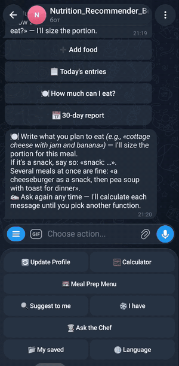
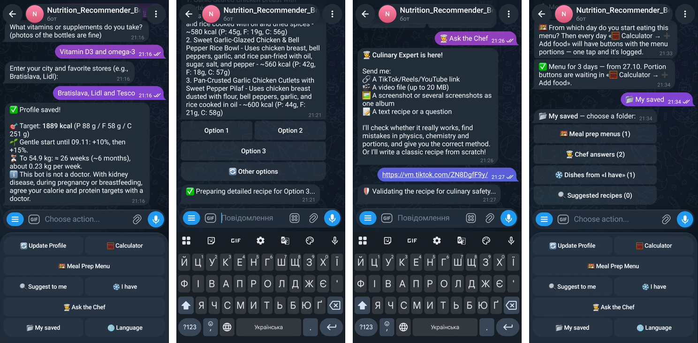

# AI Nutritionist: Telegram bot

[](https://github.com/niapard-commits/ai-nutritionist-bot/actions/workflows/check.yml)


A Telegram bot that works as a personal nutritionist and cook. It sets calorie and
macro targets, logs meals from plain text, suggests dishes from what is in your
fridge, plans meal prep with a shopping list, and checks TikTok recipes for
mistakes. The interface is available in 4 languages.

<p align="center"></p>
<p align="center"><a href="docs/demo.mp4"><b>▶ Watch the 60-second demo video</b></a></p>



## Features

| Menu | What it does |
|---|---|
| **Profile** | Short onboarding (age, height, weight, activity, goal) → daily calories and protein / fat / carbs. Understands kg/cm and lb/ft. Weight gain or loss with a gentle start |
| **Calculator** | Type what you ate ("oatmeal with banana and peanut butter") or send a photo of a label → calories logged, remaining budget shown. "How much can I eat?" suggests a meal that fits what is left |
| **I have** | List what is in the fridge → 3 dish options → full recipe for the whole pot and your portion. Leftovers are tracked for 3 days and logged with one tap |
| **Ask the Chef** | Send a TikTok / Reels / YouTube link, a video file, screenshots or text → a verdict on what is wrong (food safety, cooking times, portions) and a corrected recipe |
| **Meal Prep Menu** | 3 concepts → a plan for up to 5 days with cooking steps and a shopping list. Edit it by chatting ("replace rice with buckwheat"). Portion buttons then appear in the calculator |
| **My saved** | Menus, chef answers and dishes in folders |
| **Language** | Ukrainian, English, Slovak and Russian |

## How it works

```
nutritionist_bot.py   main bot: menus, onboarding, routing (aiogram 3)
handlers/             one module per menu: profile, calculator, fridge, expert, advisor, saved
core.py               database (SQLite, aiosqlite), translations, calorie maths, per-user limits
gemini_manager.py     Google Gemini client with key rotation and rate limiting
bot.py                second bot: extracts recipes from videos, photos and text into the database
spec.md               kitchen rules (food safety, minimum cooking times, storage) added to AI prompts
```

Design decisions:

- **The AI is checked against written rules.** `spec.md` holds numbered kitchen
  rules, for example minimum internal temperatures or "buckwheat cannot be
  'steamed' in 10 minutes". They are added to every recipe prompt, and the
  reviewer cites the rule code when it finds a violation.
- **Key manager for free-tier limits.** Several free Gemini keys are rotated
  with a per-key requests-per-minute limit and daily reset times. An optional paid
  key is used only when all free keys are exhausted, with its own daily cap.
- **Per-user limits** (`USER_RPM_LIMIT`, `USER_DAILY_LIMIT`), so one user cannot
  burn the whole quota.
- **Owner-only parser bot.** `bot.py` answers only `OWNER_ID`. Video downloads
  go to a temporary folder and are always deleted afterwards.

## Run it

Requires Python 3.11+. `yt-dlp` needs `ffmpeg` for video recipes.

```bash
git clone https://github.com/niapard-commits/ai-nutritionist-bot.git
cd ai-nutritionist-bot
python -m venv venv
venv/bin/pip install -r requirements.txt      # Windows: venv\Scripts\pip
cp .env.example .env                          # bot tokens, your Telegram ID, Gemini keys
venv/bin/python nutritionist_bot.py           # main bot
venv/bin/python bot.py                        # optional: recipe parser bot
```

The database (`nutrition_bot.db`) is created on first start. Never commit `.env`;
it is already in `.gitignore`.

## Notes

- The code comments and the kitchen rules are in Ukrainian.
- The bot is not a doctor and says so: it tells users with medical conditions to
  agree their targets with a doctor.
- This repository is a portfolio copy. The production bot runs 24/7 on a Linux
  server as a systemd service.

---

**Need an AI assistant bot for your business?** Order or ask a question via [my Fiverr gig](https://www.fiverr.com/serhii_bots/build-a-custom-python-telegram-bot).
